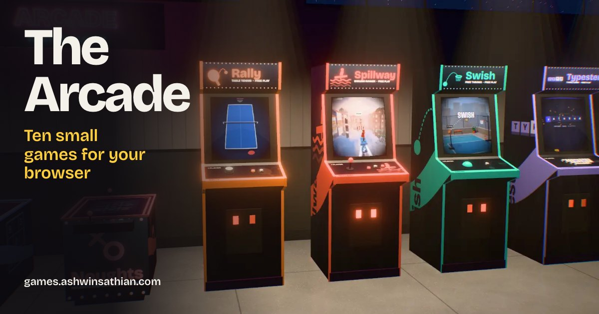

# games.ashwinsathian.com

A 3D arcade that is the front door to ten browser games: [Clover](https://clover.ashwinsathian.com) (maze chase), [Coil](https://coil.ashwinsathian.com) (snake), [Lightkeeper](https://lightkeeper.ashwinsathian.com) (pinball), [Minefield](https://minefield.ashwinsathian.com) (Minesweeper), [Nonet](https://nonet.ashwinsathian.com) (sudoku), [Noughts](https://noughts.ashwinsathian.com) (noughts and crosses), [Rally](https://rally.ashwinsathian.com) (table tennis), [Spillway](https://spillway.ashwinsathian.com) (3D endless runner), [Swish](https://swish.ashwinsathian.com) (free throws) and [Typester](https://typester.ashwinsathian.com) (typing). Each game lives in its own repository and on its own subdomain; this site links to them.



## The hall

The home page is a room drawn live in WebGL 2 (`src/arcade`), with no 3D library and no model, texture or audio files. Ten machines stand in a row, each the kind that suits its game: uprights for the arcade games, cocktail tables for the three puzzles and a pinball table for Lightkeeper. Every screen plays the game's real clip, and each machine's marquee, side art and control panel are painted on a canvas when the page opens, in the game's own two colours.

- **Camera.** A standing eye height from the front left, on a rail along the row, so you see the machine in focus, its side art and the row going away beside it. On a phone held upright the camera steps back, widens and centres. Drag or flick, use the arrow keys, a gamepad, the row of buttons, or Insert coin for a random machine. Play flies the camera into the screen, then opens the game.
- **Day and Night.** They follow the system theme until you pick one, on every page (`public/theme.js` applies it before first paint). By day the sun comes through clerestory windows with visible shafts and casts soft shadows; by night the downlights strike one by one, the neon comes on, and the screens light the floor.
- **Rendering.** A shadow map drawn once (nothing in the room moves), a half-size mirrored pass for the polished floor's reflection, a 4× multisampled HDR pass with GGX lighting from 21 lights (each screen throws its clip's average colour), contact shadows under each machine, light beams, bloom, and a neutral tone curve with a little lens fringe and grain. Resolution steps down if frames run long.
- **Sound.** A detent, a coin, the rush into a screen and the lights, synthesised with Web Audio after the visitor's first action. One switch turns it off.
- **Fallbacks.** Until the canvas draws, `public/hall/day.webp` or `night.webp` stands in. Without WebGL 2 the cards and the row work over that photograph. Save-Data keeps the screens on their posters; reduced motion cuts the camera instead of gliding and skips the fly-in; Pause clips stops the screens.

## How it works

Astro builds a fully static site into `dist`, and Cloudflare Workers serves it as static assets. The only code on the server is `worker/index.js`, which answers byte-range requests for the clips, because Safari will not play an MP4 without them. The home page is about 9 KB of gzipped HTML with its CSS inlined, one 24 KB font, a 2 KB shared script and the hall at about 22 KB.

- **Clips are real play.** `scripts/capture.ts` drives each live game with its own hooks (Coil's replay links, Lightkeeper's attract loop, Minefield's hints, Noughts' solved Fading line, Rally's `?autoplay` bot) and records nine seconds with Playwright, encoded by ffmpeg as muted H.264. In the hall only the machine in focus and its neighbours play; on a game's page a clip loads only when its tile is on screen, and never under Save-Data.
- **Skeletons.** Every picture shimmers until it arrives. A slow navigation shows a progress bar and the shape of the next page after 120 ms; prerendered pages land before that and never show it.
- **Speed.** `public/speculation.json` prerenders site pages on hover and prefetches a game's page when its Play link is hovered. Other browsers get a prefetch from `src/scripts/site.ts`. Cross-document view transitions carry a game's clip from its tile to the top of its page.
- **Search and answer engines.** Every page has a canonical URL, Open Graph and Twitter cards, and JSON-LD (`WebSite` and `ItemList` on the home page; `VideoGame` with a `VideoObject` trailer and a `BreadcrumbList` on each game page). There is a sitemap, a robots file that admits AI crawlers, and `/llms.txt` built from the same data as the pages.

All copy and game facts live in `src/data/games.ts`.

## Commands

```sh
npm install
npm run dev        # http://localhost:4330
npm test           # build, then check meta, JSON-LD, font coverage, CSP, byte budgets, the hall, headers
npm run capture    # re-record the clips from the live games (needs ffmpeg and ../coil)
npm run hall       # re-photograph the hall, Day and Night, into public/hall (needs a GPU), then build again
npm run og         # re-draw the social cards from the built /og pages, then build again
npm run deploy     # build and deploy to Cloudflare
```

The font is the portfolio's cut of Bricolage Grotesque (Latin, weights 400 to 800). `npm test` fails if a page uses a character outside it.

## Licence

MIT. The games' screenshots and clips come from the games themselves, which are MIT-licensed too.
