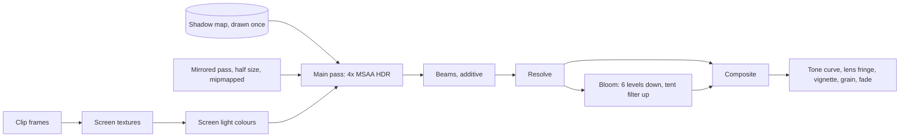

# Architecture

The site is static HTML from Astro, served by Cloudflare. The home page adds one module, the hall, which draws the arcade in WebGL 2 over a photograph of itself. This page covers how the hall is put together and the few contracts it depends on.

## Files

| File | Role |
| --- | --- |
| `src/arcade/core.ts` | Matrix maths, WebGL helpers and the mesh builder. Every face is wound from the normal it is given, so back faces can be culled everywhere. |
| `src/arcade/scene.ts` | Geometry for the three machine types (upright, cocktail table, pinball), the room, the drinks machine and the light beams. Each machine maps its art onto one 1024×1344 canvas. |
| `src/arcade/art.ts` | Canvas painters for marquees, side art, control panels, table tops, the neon and the drinks machine, plus a motif per game. Each painter draws into the rectangle it is given. |
| `src/arcade/shaders.ts` | One lit shader for every surface (material chosen per vertex), a depth shader, the beam shader and the post chain. |
| `src/arcade/hall.ts` | The renderer, the camera rail, pointer input, picking, and the video screens. |
| `src/arcade/sound.ts` | Synthesised effects and the ambient room. |
| `src/scripts/arcade.ts` | The page side: card, row, keyboard, gamepad, attract mode, last played, bests, sound and hints. |

## A frame



- **Shadows.** Nothing in the room moves, so the sun's shadow map is drawn once at start-up and sampled with eight rotated taps.
- **Floor.** The hall is drawn a second time, mirrored under the floor, into a half-size target. The floor samples it by screen position at a mip level set by its roughness, with a Fresnel weight, so the reflection blurs where the concrete is matte.
- **Light.** GGX specular and Lambert diffuse, a hemisphere ambient, an analytic room for reflections, and up to 24 point and spot lights. Each screen is a light whose colour is the average of its clip, sampled from a 4×4 canvas a few times a second. Each machine casts a soft contact shadow on the floor from its footprint.
- **Day and Night** is one number from 0 to 1 that drives the sun, the sky, exposure, bloom, the downlights (which come on in order, with a flicker) and the neon.
- **Budget.** The canvas is capped at 3.2 million pixels on a laptop and 1.9 million on a touch device. If frames run long for two seconds, the resolution drops by a fifth.

## The camera

The camera rides a rail along the row, at eye height and from the front left, and springs to the machine in focus. The page measures the part of the canvas its interface leaves free and passes it to the hall as fractions (`hall.free`). The hall then:

1. Sets the field of view so that about 2.5 m of hall fits the free height and at least 2 m fits the free width.
2. Shifts the lens (an off-axis projection) so the machine is centred in the free part rather than on the canvas.

This makes the same code frame a laptop (beside the card), a phone held upright (above the card), a phone held sideways (between the bars, right of the card) and a tablet in either orientation. Play eases the camera into the screen, drops the lens shift, and fades to the game's colour.

## Best scores

Each game writes its headline best to a cookie that every subdomain can read:

```
arcade_best_<slug> = encodeURIComponent(JSON.stringify({ v, l }))
; Domain=ashwinsathian.com; Path=/; Max-Age=31536000; SameSite=Lax; Secure
```

- `v` is the best as the game displays it, at most 12 characters, for example `"12,340"` or `"1:42.3"`.
- `l` is a label, at most 14 characters, for example `"Classic"` or `"Expert"`.

The arcade treats the cookie as input. It accepts strings only, strips anything that is not a letter, number, punctuation or space, cuts both fields to length, and only ever writes them as canvas text or `textContent`. When the visitor comes back from a game through the back button, the page reads the cookies again and repaints that marquee.

## State kept on the device

| Key | Where | What |
| --- | --- | --- |
| `games:lights` | localStorage | `day` or `night`; absent means follow the system |
| `games:still` | localStorage | Clips paused |
| `games:sound` | localStorage | `0` when sound is off |
| `games:last` | localStorage | Slug of the last game played |
| `games:swiped` | localStorage | The swipe hint has been seen |
| `arcade_best_*` | cookie | Written by the games, read here |

There is no analytics and no server state.

## Workers

- `worker/index.js` runs for `/media/*` only and answers byte-range requests, because Safari will not play an MP4 that cannot be fetched by range. Everything else comes straight from static assets.
- `worker/redirect.js` is deployed under the old Worker's name and holds games.ashwinsathian.com. It answers every request with a 301 to the same path and query on arcade.ashwinsathian.com.
